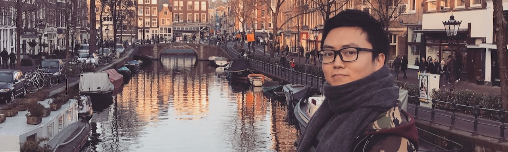
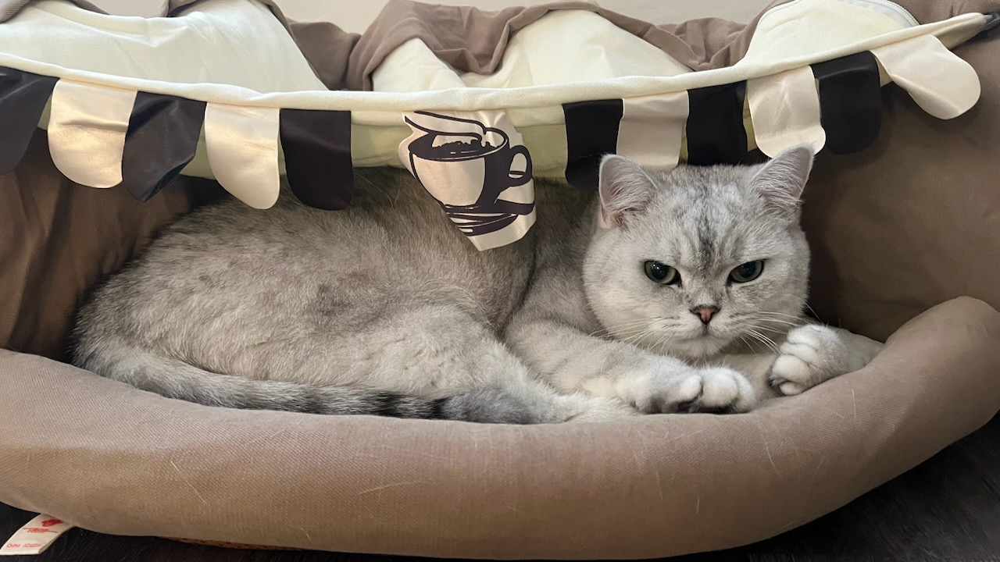

{fig-align="center" width="800"}

I am a research data scientist and open-source software developer with a PhD in Systems Engineering from [George Washington University](https://www.gwu.edu/), advised by Professor [John Helveston](https://www.jhelvy.com). Before my PhD, I worked in industry as a software engineer at Harsco Rail, an engineering consultant to Daimler Greater China, and a project engineer at GE Appliances.

```{=html}
<div class="about-docs">
 <a class="masthead-doc" href="resume.pdf" target="_blank"><span class="glyph glyph-file-text" aria-hidden="true"></span>Resume</a>
 <a class="masthead-doc" href="cv.pdf" target="_blank"><span class="glyph glyph-file-cv" aria-hidden="true"></span>CV</a>
</div>
```

## Research {.about-label}

::: {.about-more}
[All research](research.qmd)
:::

My doctoral research was funded by the .



## Expertise {.about-label}

### Degrees {.about-title .glyph-school}

```{=html}
<ol class="about-rail">
 <li>
  <span class="about-year">2026</span>
  <p class="about-degree"><strong>Ph.D.</strong> Systems Engineering</p>
  <p class="about-note"><a class="about-tool" href="https://www.emse.seas.gwu.edu"><span class="about-tool-mark"></span>George Washington University</a>, advised by Professor <a href="https://www.jhelvy.com">John Helveston</a>.</p>
 </li>
 <li>
  <span class="about-year">2018</span>
  <p class="about-degree"><strong>M.P.E.</strong> Mechanical Engineering</p>
  <p class="about-note"><a class="about-tool" href="https://www.sydney.edu.au/engineering/study/undergraduate-courses/mechanical-engineering.html"><span class="about-tool-mark"></span>University of Sydney</a>, assessed by <a class="about-tool" href="https://www.engineersaustralia.org.au"><span class="about-tool-mark"></span>Engineers Australia</a>.</p>
 </li>
 <li>
  <span class="about-year">2015</span>
  <p class="about-degree"><strong>B.S.</strong> Industrial Engineering</p>
  <p class="about-note"><a class="about-tool" href="https://www.ime.psu.edu"><span class="about-tool-mark"></span>Penn State University</a>, with a minor in Six Sigma.</p>
 </li>
</ol>
```

### Skills {.about-title .glyph-tools}

```{r}
#| echo: false
#| results: asis
# the table is shared with the resume and CV; see the script
source(here::here("resources/scripts/skills.R"))
cat(skills_html())
```

### Languages {.about-title .glyph-language}



## Personal Life {.about-label}

I have lived and worked in China, the USA, Germany, and Australia. I now live in Greater Melbourne as an Australian permanent resident, with my wife and our cat, Pinocchio.

::: {style="text-align: center;"}
{fig-alt="Pinocchio" width="600"}
:::
