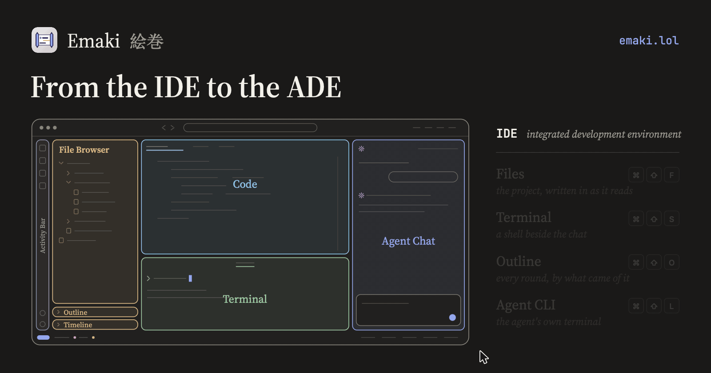



Agents changed how I write software, but not where I do it. A normal day still looked like this: my AI agent in a terminal, Finder for the files, GitHub Desktop for the commits, another terminal for quick commands, and a browser or a PDF viewer to look at what the agent just made. The agent did most of the work. I spent my day walking between windows to keep up with it.

So I collaborated with my advisor, [Dr. John Helveston](https://www.jhelvy.com), and built the app we wanted. We formed a small studio, [Alkaline Software](https://github.com/alkaline-software), and **Emaki** is its first and flagship product: an agentic development environment, or ADE.

<figure class="emk-shot">
 
 
 <figcaption class="emk-cap">From the IDE to the ADE: nicely rendered chat UI with numerous supportive panels.</figcaption>
</figure>

## Why Emaki



An *emaki* (絵巻) is a Japanese picture handscroll like the one above, a long painted scene read by winding it from one roll to the other. Move your pointer across this one and it winds. It is colorful, enchanting and easy to handle, which is what we want the app to be. We were inspired by emaki's layout and decided to use it as the name of our new app.

Emaki came out of three pains I had every day.

**Interface matters.** Claude Code and Codex are terminal apps (TUIs). A TUI is fine for a quick task, but it is a hard place to spend a whole day: long answers scroll away, tables wrap badly, and finding what the agent said an hour ago means scrolling through everything in between. A window with rendered text, buttons and a mouse is easier for everyone, and above all for someone new to agents.

**Sessions are hard to manage.** With the vanilla agent CLIs, we tend to create tons of sessions without realizing it. After a few months there are hundreds of them, spread across projects and agents, and each agent stores them its own way. Some agents also clean up without asking: Claude Code deletes its transcripts after 30 days. I want to see my sessions, pick up an old one, delete the ones I no longer need, and archive or unarchive the rest.

**One project, five windows.** A typical project needs Finder (File Explorer on Windows) for the files, GitHub Desktop for the repository, a terminal for quick commands, several apps to look at the results, and the TUI or GUI of each agent. Each is fine alone. Switching among them all day is the pain.



If there could be one window that takes all these pains away, that's Emaki.

## IDE vs ADE

An IDE (integrated development environment) is made for handcrafting with the editor taking the middle of the screen, surrounded by other supportive panels like the file tree, git management, and terminals. Thanks to the extension system, agent UIs and TUIs are supported in a basic way, but still, they only stay at the edge or corner. In my typical experience of using an IDE, the middle zone is usually empty (since I don't code anymore and mainly use AI agents for production), and I heavily rely on the agent TUI at the corner, and I believe the same is true for lots of other developers.

Emaki turns the layout around and we call it an ADE (agentic development environment). The well-rendered chat GUI takes the main space, with the sidebar grouping your sessions under their projects, and that's it. The main UI only consists of the sidebar and the main conversation panel, which covers most of the user experience.

But we didn't stop here. Emaki must be versatile, working like a Swiss Army knife, and thus provides the most suitable features when needed: file system, git system, preview, editing, conversation outline, original agent CLI, and terminal panels. Check out the details in the [Features] section.

**Yes, we guarantee that Emaki supports them all while retaining an easy-to-use UI. If you are interested, feel free to download and give it a try!**

Emaki works with Claude Code and Codex on macOS, Windows and Linux, and it is open source under the MIT license. It does not replace your agents. It gives them a better place to work.

## Features

As discussed above, Emaki's UI consists of two parts: projects in the sidebar, and rendered chats as the main panel.



**Projects.** Every session belongs to a project, and the sidebar lists Claude Code and Codex sessions side by side, each led by its agent's logo. A dot shows where a session stands:



From the sidebar you can start, resume, archive or delete a session. All Sessions, on <span class="keys"><kbd>⌘</kbd><kbd>L</kbd></span>, lists every one of them with the day it was last used, and <span class="keys"><kbd>⌘</kbd><kbd>K</kbd></span> searches their text. Emaki copies every Claude Code session into `~/.emaki/archive`, so a session that Claude Code has deleted is still here.

**Chats.** Agent responses are nicely rendered. The artifacts, subagents, Q&A sessions, and background tasks are all taken care of with a smooth UI. The composer supports grammar check, `@` and `/` commands, and instant toggling among your available models, modes, and efforts.

Other than the above main parts, there are also 4 components that support all your needs in your development or composition.



**Files.** The Files Panel is a file tree with git's changes marked on it. Click a file and it opens beside the chat. Markdown, Quarto, LaTeX and Typst open in a rendered editor, where you edit the document as it reads, and <span class="keys"><kbd>⌘</kbd><kbd>⇧</kbd><kbd>V</kbd></span> switches to the raw file and back. Code opens in an editor, and the rest in a preview. These are the types it opens:



Git lives in the panel's header and only appears if your current project is detected as a repo. With it, you can manage your branches and trigger common actions like `fetch`, `pull` and `push`. You can also toggle the Changes sheet with <span class="keys"><kbd>⌘</kbd><kbd>⇧</kbd><kbd>G</kbd></span>. In this sheet, you can manually commit and push, as well as view your past commits. For my daily commits, this replaced GitHub Desktop.

**Terminal.** The Terminal Panel gives you terminal tabs that already open in the project's folder, so there is no more `cd`. Its look is inspired by [Kaku](https://kaku.fun), a terminal made by [tw93](https://github.com/tw93).



**Outline.** The Outline is a drawer at the chat's left that lists every round of a long session under its day, each with its time and a short label. Click an entry to jump back to it.

**Agent CLI.** Your agent's original CLI is still here; it runs the same session and can be easily switched with the rendered UI.

Here are the main keys. You can change any of them in Settings, and where a Mac has <kbd>⌘</kbd>, Windows and Linux have <kbd>Ctrl</kbd>.



There is more: Connected Devices to work on another Mac or a Linux computer over ssh, light and dark themes with seven accent colors, eight languages for the window, and your data kept in `~/.emaki` on your own computer.

## Get Started

Getting started takes three steps, and the third is optional:



Upon launching Emaki, proceed to the Agents page either by pressing <span class="keys"><kbd>⌘</kbd><kbd>E</kbd></span> or by clicking on the tab at the top left. On this page you can have a clear view of what has been installed and what is missing. Emaki will guide you through all the checks and the installation process. If all is installed, feel free to choose a project, pick an agent, and start your conversation. For more information please check out our official [website](https://emaki.lol/).

## Summary

Emaki gives your agents a nice GUI along with a Swiss Army knife user experience. It keeps every session where you can see it, and you have the file system, git, terminal, preview, and editing whenever you need them, so one window holds the whole project. It is open source, and we are actively improving it.

```{=html}
<script src="resources/figures.js"></script>
<script src="resources/hero-scroll.js"></script>
<script src="resources/download.js"></script>
```
