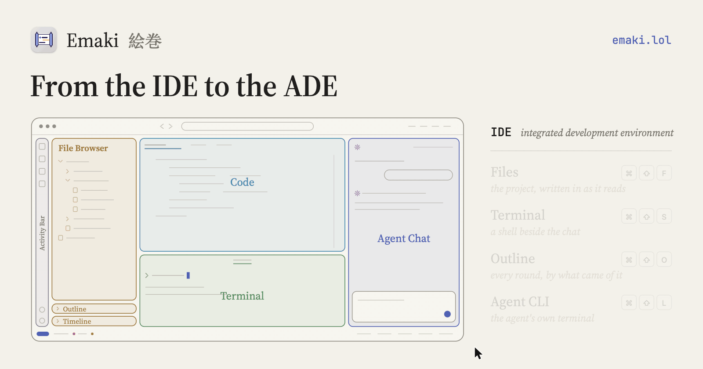



Agents changed how I write software, but not where I do it. A normal day still looked like this: my AI agent in a terminal, Finder for the files, GitHub Desktop for the commits, another terminal for quick commands, and a browser or a PDF viewer to look at what the agent just made. The agent did most of the work. I spent my day walking between windows to keep up with it.

So my advisor, [Dr. John Helveston](https://www.jhelvy.com), and I built the app we wanted. We formed a small studio, [Alkaline Software](https://github.com/alkaline-software), and **Emaki** is its first and flagship product: an agentic development environment, or ADE.

<figure class="emk-shot">
 
 <figcaption class="emk-cap">From the IDE to the ADE: the chat takes the middle, and the rest waits at its sides.</figcaption>
</figure>

## Why Emaki

Emaki came out of three pains I had every day.

**A terminal is not a home.** Claude Code and Codex are terminal apps (TUIs). A TUI is fine for a quick task, but it is a hard place to spend a whole day: long answers scroll away, tables wrap badly, and finding what the agent said an hour ago means scrolling through everything in between. A window with rendered text, buttons and a mouse is easier for everyone, and above all for someone new to agents.

**Sessions pile up, then disappear.** Every task starts a session. After a few months there are hundreds of them, spread across projects and agents, and each agent stores them its own way. Some agents also clean up without asking: Claude Code deletes its transcripts after 30 days. I want to see my sessions, pick up an old one, delete the ones I no longer need, and archive or unarchive the rest.

**One project, five windows.** A typical project needs Finder (File Explorer on Windows) for the files, GitHub Desktop for the repository, a terminal for quick commands, several apps to look at the results, and the TUI or GUI of each agent. Each is fine alone. Switching among them all day is the pain.



We wanted one window that takes all three pains away, and we named it after a scroll.



An *emaki* (絵巻) is a Japanese picture handscroll like the one above, a long painted scene read by winding it from one roll to the other. Move your pointer across this one and it winds. It is colorful, enchanting and easy to handle, which is what we want the app to be.

## IDE vs ADE

An IDE, an integrated development environment, is made for hand crafting: the editor takes the middle of the screen, and the agent chat gets a narrow pane at the edge. Agentic work is the other way around, so Emaki turns the layout around. The chat takes the main space, the sidebar groups your sessions under their projects, and the files, a terminal, the outline and the agent's own CLI stay hidden until you need them. That is what we call an ADE.

Here is what that layout does about the three pains:



Emaki works with Claude Code and Codex on macOS, Windows and Linux, and it is open source under the MIT license. It does not replace your agents. It gives them a better place to work.

## Features

Emaki's window has six parts, shown below two at a time. The figures are the ones from Emaki's website: move your pointer over one and its part comes forward, and click it to open that part's docs.



**Projects.** Every session belongs to a project, and the sidebar lists Claude Code and Codex sessions side by side, each led by its agent's logo. A dot shows where a session stands:



From the sidebar you can start, resume, archive or delete a session. All Sessions, on <span class="keys"><kbd>⌘</kbd><kbd>L</kbd></span>, lists every one of them with the day it was last used, and <span class="keys"><kbd>⌘</kbd><kbd>K</kbd></span> searches their text. And nothing gets lost: Emaki copies every Claude Code session into `~/.emaki/archive`, so a session that Claude Code has deleted is still here.

**Chats.** The transcript is rendered, so headings, tables and code read as they should. A run of tool calls folds into one row, and the agent's questions come up as cards. In the composer, `@` picks a file, `/` lists the agent's commands and skills, and `!` runs a shell command. Three pills under it switch the mode, the model and the effort, and a status line shows how much of the context window and the usage limits you have used.



**Files.** The Files Panel is a file tree with git's changes marked on it. Click a file and it opens beside the chat. Markdown, Quarto, LaTeX and Typst open in a rendered editor, where you edit the document as it reads, and <span class="keys"><kbd>⌘</kbd><kbd>⇧</kbd><kbd>V</kbd></span> switches to the raw file and back. Code opens in an editor, and the rest in a preview. These are the types it opens:



The point of the panel is that you and the agent work on the same files. The agent does the heavy writing, and when its draft is close but not quite what I want, I fix the rest by hand, in the raw file or the rendered one, without leaving the window. This post was written that way.

Git lives in the panel's header, where you switch or create a branch and fetch, pull and push. The Changes sheet, on <span class="keys"><kbd>⌘</kbd><kbd>⇧</kbd><kbd>G</kbd></span>, is where you review your changes, write a commit message and see past commits. For my daily commits, this replaced GitHub Desktop.

**Terminal.** The Terminal Panel gives you terminal tabs that already open in the project's folder, so there is no more `cd`. Its look is inspired by [Kaku](https://kaku.fun), a terminal made by [tw93](https://github.com/tw93).



**Outline.** The Outline is a drawer at the chat's left that lists every round of a long session under its day, each with its time and a short label. Click an entry to jump back to it.

**Agent CLI.** Your agent's original CLI is still here, running the same session in the chat's place. A message typed in either shows in the other, so nothing the CLI can do is taken away.

Here are the main keys. You can change any of them in Settings, and where a Mac has <kbd>⌘</kbd>, Windows and Linux have <kbd>Ctrl</kbd>.



There is more: Connected Devices to work on another Mac or a Linux computer over ssh, light and dark themes with seven accent colors, eight languages for the window, and your data kept in `~/.emaki` on your own computer.

## Get Started

Getting started takes three steps, and the third is optional:



Once Emaki is open, its Agents page, on <span class="keys"><kbd>⌘</kbd><kbd>E</kbd></span>, checks what you have installed and walks you through the rest. Then choose a folder, pick an agent, and type your first prompt. The [docs](https://emaki.lol/docs/) cover everything else.

## Summary

Emaki gives your agents a window instead of a terminal, keeps every session where you can see it, and puts the files, git, a terminal and previews around the chat, so one window holds the whole project. It is open source, and John and I keep improving it. Give it a try and tell us what you think on [GitHub](https://github.com/alkaline-software/emaki). Cheers~

```{=html}
<script src="resources/figures.js"></script>
<script src="resources/hero-scroll.js"></script>
<script src="resources/download.js"></script>
```
