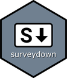

```{=html}
<div class="masthead">
 <div class="masthead-head">
  <!-- Not an <h1>: with no title, Quarto would lift a leading h1 into its title block. -->
  <p class="masthead-name" role="heading" aria-level="1">Pingfan Hu</p>
  <ul class="masthead-facts">
   <li><span class="glyph glyph-map-pin" aria-hidden="true"></span>Greater Melbourne, Australia</li>
   <li><span class="glyph glyph-briefcase" aria-hidden="true"></span>Research data scientist, co-founder of Alkaline Software</li>
   <li><span class="glyph glyph-certificate" aria-hidden="true"></span>Ph.D. in Systems Engineering, George Washington University</li>
  </ul>
  <p class="masthead-bio">I use discrete choice models to study human behavior in sustainable transportation. I build open-source <span class="glyph glyph-r" role="img" aria-label="R"></span> tools for survey research. I teach agentic engineering with Claude Code, and develop software with fully agentic workflows.</p>
  <div class="masthead-actions">
   <a class="masthead-doc" href="resume.pdf" target="_blank"><span class="glyph glyph-file-text" aria-hidden="true"></span>Resume</a>
   <a class="masthead-doc" href="cv.pdf" target="_blank"><span class="glyph glyph-file-cv" aria-hidden="true"></span>CV</a>
   <span class="masthead-sep" aria-hidden="true"></span>
   <a class="masthead-icon" href="https://www.linkedin.com/in/pingfan/" target="_blank" rel="noopener" aria-label="LinkedIn" title="LinkedIn"><span class="glyph glyph-linkedin-square"></span></a>
   <a class="masthead-icon" href="https://github.com/pingfan-hu" target="_blank" rel="noopener" aria-label="GitHub" title="GitHub"><span class="glyph glyph-github-square"></span></a>
   <a class="masthead-icon" href="https://orcid.org/0009-0001-4877-4844" target="_blank" rel="noopener" aria-label="ORCID" title="ORCID"><span class="glyph glyph-orcid-square"></span></a>
   <a class="masthead-icon" href="https://www.researchgate.net/profile/Pingfan-Hu-2" target="_blank" rel="noopener" aria-label="ResearchGate" title="ResearchGate"><span class="glyph glyph-researchgate-square"></span></a>
   <a class="masthead-icon" href="https://scholar.google.com/citations?hl=en&amp;user=cHRn7ysAAAAJ" target="_blank" rel="noopener" aria-label="Google Scholar" title="Google Scholar"><span class="glyph glyph-scholar-square"></span></a>
  </div>
 </div>
 
 <div class="masthead-work">
  <!-- A card with a paper is a pair: the card, its title link stretched over
       it, and behind its foot the paper as a drawer, its own link. -->
  <div class="masthead-pair">
   <div class="masthead-item">
    <span class="masthead-kind">Research</span>
    <a class="masthead-title" href="research/2024-sc-adoption/index.html">EV smart charging</a>
    <span class="masthead-desc">Consumer preferences for supplier-managed charging.</span>
   </div>
   <a class="masthead-pub" href="https://doi.org/10.1088/1748-9326/ae2597" target="_blank" rel="noopener" title="Environmental Research Letters, 2025"><span class="masthead-pub-text">Environmental Research Letters, 2025</span></a>
  </div>
  <div class="masthead-pair">
   <div class="masthead-item">
    
    <span class="masthead-kind"><span class="glyph glyph-r" role="img" aria-label="R"></span> package</span>
    <a class="masthead-title" href="research/2024-surveydown/index.html">surveydown</a>
    <span class="masthead-desc">Markdown-based, reproducible surveys in <span class="glyph glyph-r" role="img" aria-label="R"></span>.</span>
   </div>
   <a class="masthead-pub" href="https://doi.org/10.1371/journal.pone.0331002" target="_blank" rel="noopener" title="PLOS ONE, 2025"><span class="masthead-pub-text">PLOS ONE, 2025</span></a>
  </div>
  <div class="masthead-item">
   
   <span class="masthead-kind">Studio</span>
   <a class="masthead-title" href="https://emaki.lol" target="_blank" rel="noopener">Emaki</a>
   <span class="masthead-desc">An agentic development environment, built in Rust with GPUI at Alkaline Software.</span>
  </div>
 </div>
</div>
```
